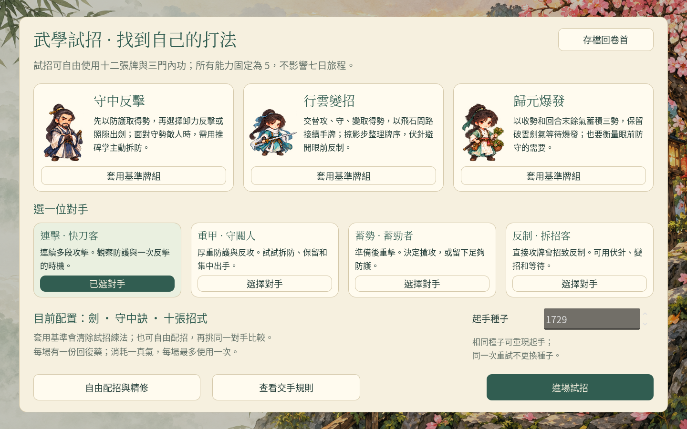
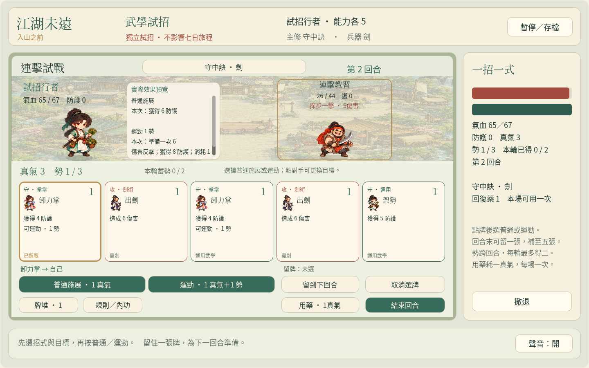

# 江湖未遠：內功與蓄勢

可玩的武學核心驗證版：**一門內功、十張招式，決定何時守、何時變、何時運勁。**

## 下載與開始

**[下載瀏覽器試玩包 ZIP](https://github.com/cclodty/Game-develop-rpg-wusha/raw/refs/heads/weiyuan-martial-download/jianghu-weiyuan-martial-web.zip)**

1. 下載後在 ZIP 上按右鍵，選「全部解壓縮」。
2. 進入解壓後的資料夾，雙擊 **Play-Windows.cmd**。
3. 遊戲會在瀏覽器開啟；保留啟動視窗。
4. 在主畫面選 **「武學試招」**，就能選牌組與對手。

Windows 不需安裝 Godot 或 Python。這是下載後在本機瀏覽器執行的版本，GitHub 頁面本身不是遊戲畫面。若未自動開啟，待啟動視窗顯示 ready 後，開啟 `http://127.0.0.1:8072/`。macOS／Linux 可在解壓後執行 `python3 tools/serve_web.py`。

## 本版可以試什麼

- **守中反擊、行雲變招、歸元爆發**三套示範牌組；十二招式可自由混搭。
- 勢可跨回合保留；每次出招明確選擇普通或運勁，回合末可留一張牌。
- 三張代表牌各有兩種精修練法，可比較防守、換牌與爆發的取捨。
- 四類對手：連擊、重甲、蓄勢與反制。敵方意圖公開，沒有出牌倒數。
- 想走故事可選「啟程」，經情境建角後開始七日學武、探索與選拔。

試招與七日旅程分開保存，試招不會替正式角色增加能力。換牌中的選擇也能存讀。使用相同瀏覽器與網址續玩；清除網站資料會移除本機存檔。

## 原始碼與驗證

- [原始碼與完整企劃](https://github.com/cclodty/Game-develop-rpg-wusha/tree/weiyuan-martial-core)
- [Godot 原始碼 ZIP](https://github.com/cclodty/Game-develop-rpg-wusha/raw/refs/heads/weiyuan-martial-download/jianghu-weiyuan-martial-source.zip)
- [ZIP 的 SHA256 校驗碼](SHA256SUMS.txt)
- [發佈與下載校驗記錄](validation/release.json)、[原生測試](validation/native.log)、[完整瀏覽器測試](validation/web-result.json)、[最終文案補驗](validation/web-final-copy-result.json)

Godot 4.6.3、Dialogue Manager 3.10.4。原生測試通過 5,859 項檢查，包含 72 場以合法牌組與配點完成的試戰；瀏覽器以實際滑鼠鍵盤檢查建角、出牌及存讀。

完整瀏覽器測試為九組流程。最後修正兩行建角教學文字後，重新匯出並補驗兩組建角流程；兩份記錄各自保留對應的匯出校驗碼。

這是玩法驗證版。三名首次玩家仍待實測，普通戰鬥 2–4 分鐘、完整首篇 30–60 分鐘是待驗證目標；Windows 桌面與中文輸入法亦待實機驗證。刀法、指爪、長兵及醫毒的正式牌池留待後續擴充。

舊版仍可下載：[十八牌版本](https://github.com/cclodty/Game-develop-rpg-wusha/tree/weiyuan-cards-download)、[即時戰鬥版本](https://github.com/cclodty/Game-develop-rpg-wusha/tree/weiyuan-download)、[早期對話原型](https://github.com/cclodty/Game-develop-rpg-wusha/tree/playable-download)。
