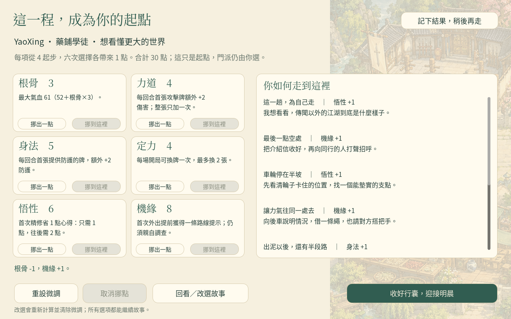
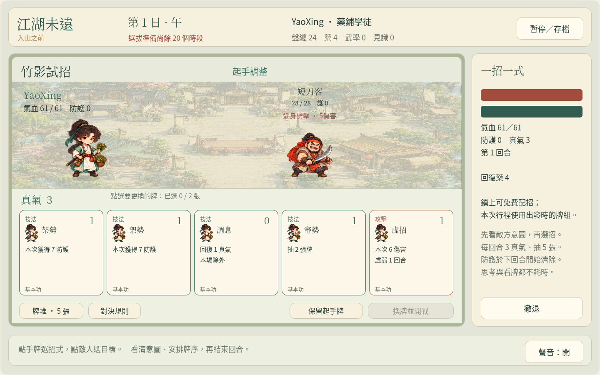

# 江湖未遠：入山之前

**先決定怎樣走進江湖，再安排自己的七天。**

這是一個可玩的原創 Q 版武俠卡牌養成原型：以六次情境選擇建立主角，親自走訪望溪鎮，在七日早／午／晚共 21 個時段內學武、交友與探索，再用自己配置的十張招式牌參加第八日選拔。

**[下載卡牌試玩包](https://github.com/cclodty/Game-develop-rpg-wusha/raw/refs/heads/weiyuan-cards-download/jianghu-weiyuan-cards-web.zip)**：全部解壓縮後，Windows 雙擊 `Play-Windows.cmd`，遊戲會在瀏覽器開啟。也可查看[下載頁與驗證記錄](https://github.com/cclodty/Game-develop-rpg-wusha/tree/weiyuan-cards-download)或[卡牌版原始碼分支](https://github.com/cclodty/Game-develop-rpg-wusha/tree/weiyuan-card-prototype)。

本輪 **3,707 項原生自動化檢查、7 組真實 Chromium 操作流程通過**；包含三出身建角、存讀、免費配招及一場實際出牌勝出。[驗證範圍與限制](docs/VALIDATION.md)另列，這些結果不代表真人試玩已完成。既有 [weiyuan-download](https://github.com/cclodty/Game-develop-rpg-wusha/tree/weiyuan-download) 保留即時動作原型。

## 這一版的玩法

- **情境建角：**自訂姓名、選擇藥鋪學徒／驛站跑腿／戲班子弟，經歷兩次問答、三次泥車協作與一次歇腳回顧。六項能力各從 4 開始，六次選擇後總和 30，可移動最多兩點微調。
- **自由養成：**城鎮行走與一般交談免費；正式活動明示成本。兩條準備路線可混合，沒有時間完成所有事情。
- **回合制招式：**18 種牌、固定十張牌組、同種最多兩張；每回合抽五張、三點真氣，先看敵意圖再決定攻防。出牌沒有反應倒數。
- **學會再配招：**兩派武學、三種出身手藝與四種事件招式都可學；鎮上沒有進行中活動時可免費配牌。練習心得可精修牌種，兩個複本一起生效。
- **多種收束：**照嶺門、渡雲社或留鎮續修；出身不鎖門派，認輸也能完成首篇。

序章 **6–8 分鐘**、首篇 **30–60 分鐘**是設計目標，尚未以真人驗收。已備妥 [試玩流程與三份待測紀錄](docs/PLAYTEST_PROTOCOL.md)，沒有宣稱已招募或完成三位測試。

## 開發環境與操作

使用 **Godot 4.6.3 標準版**開啟 `project.godot`，等待匯入後按 F5；也可執行 `bash tools/run.sh`。Dialogue Manager v3.10.4 隨專案附上，不需要 .NET 或 Scenario 帳號。

| 場景 | 操作 |
|---|---|
| 建角、對話、回顧與微調 | 畫面選項；可回看先前選擇 |
| 城鎮／探索行走 | WASD／方向鍵，或點擊地面 |
| 與人物／目標互動 | 走近後 F／Enter，或點擊人物靠近 |
| 卡牌戰鬥 | 先看意圖與牌面，再點牌施放；多個對手時再選目標；按鈕結束回合 |
| 配牌、精修、行程、地圖、紀事 | 畫面按鈕；鎮上「角色與配招」不耗時 |
| 暫停／保存 | Esc 或暫停面板；平時亦會自動存檔 |

新牌會加入已學招式，**不會自動換進十張上場牌**。正式活動開始後，牌組與能力鎖定到該活動；戰敗重試不重扣時段，也不重新抽取出發種子。撤退保留已花時間，放棄未完成獎勵。

## 文件

- [遊戲企劃](docs/GAME_DESIGN.md)：建角、七日成本、兩條路線及錄取。
- [序章完整樣稿](docs/PROLOGUE_SAMPLE.md)：六題、十八分支與三出身回應。
- [卡牌設計](docs/CARD_DESIGN.md)：十八種牌、精修、敵意圖與戰鬥規則。
- [故事設定](docs/STORY_BIBLE.md)與[寫作指南](docs/WRITING_GUIDE.md)：人物、動機與 Dialogue Manager 接入。
- [美術規格](docs/ART_DIRECTION.md)：既有 Q 版素材的沿用與新版閱讀要求。
- [整合合約](docs/BUILD_CONTRACT.md)與[卡牌介面](docs/CARD_CONTRACT.md)：實際資料與系統邊界。
- [真人試玩流程](docs/PLAYTEST_PROTOCOL.md)與[版本驗證記錄](docs/VALIDATION.md)。
- [歷史動作原型](docs/history/action-prototype/INDEX.md)：保留舊企劃、驗證與下載說明。

## 獨立交付與存檔

卡牌版使用獨立 [weiyuan-cards-download](https://github.com/cclodty/Game-develop-rpg-wusha/tree/weiyuan-cards-download) 分支；包名為 `jianghu-weiyuan-cards-web.zip` 與 [jianghu-weiyuan-cards-source.zip](https://github.com/cclodty/Game-develop-rpg-wusha/raw/refs/heads/weiyuan-cards-download/jianghu-weiyuan-cards-source.zip)。本地打包輸出在 `artifacts/cards-release/`，不覆蓋舊 `weiyuan-download` 或 `artifacts/release/`。

Windows 包以內建 PowerShell 啟動：全部解壓縮，再雙擊 `Play-Windows.cmd`。macOS／Linux 可用 `python3 tools/serve_web.py`。新網址固定為 `http://127.0.0.1:8071/`，舊動作版 8070 和《山河行》8060 保留；不要直接雙擊 WebAssembly 的 `index.html`。

卡牌版使用 **`user://run-cards-v2.json`**，不載入或覆寫動作版 `run-v1.json`。瀏覽器存檔屬目前網站來源的 IndexedDB，請使用同一瀏覽器與網址；清除網站資料會移除該存檔。沒有雲端帳號同步。

主要驗證目標為桌面鍵盤滑鼠、1440×900 與 Chromium 系瀏覽器；手機、手把、Safari、中文輸入法與真正 Windows 實機的完成狀態均須另記。第三方授權見 [THIRD_PARTY_NOTICES.md](THIRD_PARTY_NOTICES.md)。

開發者可用 `bash tests/run_tests.sh` 執行原生套件；安裝 Python Playwright 與 Chromium 後，先 `bash tools/export_web.sh`，再執行 `python3 tools/test_cards_web.py`。瀏覽器測試只讀存檔核對，不注入遊戲狀態。`python3 tools/package_release.py` 會封裝已匯出的版本及原始碼，排除玩家存檔、快取與測試產物。
