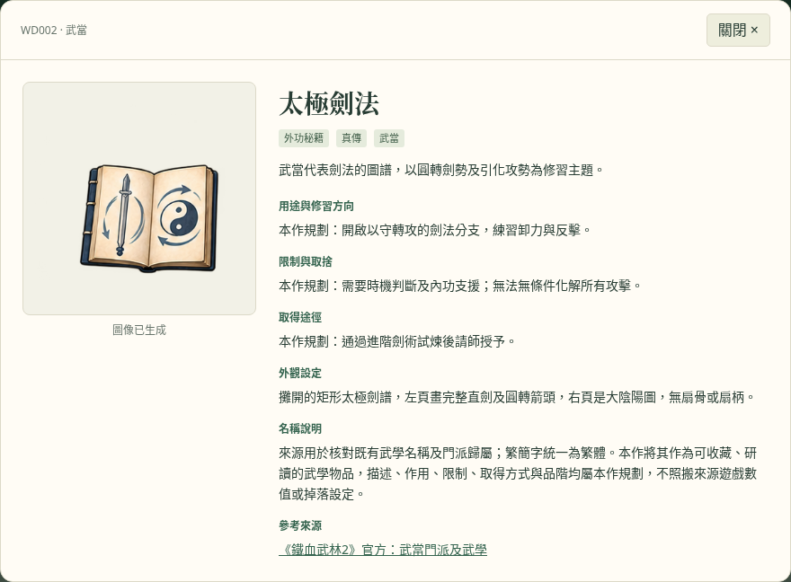

# 武俠物品庫：368 件縮圖核對版 v3

**[下載完整資料與圖片包（約 34 MB）](https://github.com/cclodty/Game-develop-rpg-wusha/raw/refs/heads/wuxia-items-download/wuxia-items-368.zip)**

如果點擊後未開始下載，請開啟 [ZIP 檔案頁](https://github.com/cclodty/Game-develop-rpg-wusha/blob/wuxia-items-download/wuxia-items-368.zip)，按右上方的 **Download raw file／下載原始檔** 按鈕。

## 開啟圖鑑

1. 下載 ZIP，按「全部解壓縮」。
2. 進入 `wuxia-item-library` 資料夾。
3. 雙擊 `index.html`，用瀏覽器查看與搜尋；不需要安裝遊戲引擎、Python 或啟動伺服器。

GitHub 檔案頁只顯示 HTML 原始碼；下載並解壓後才可使用互動圖鑑。

[武當圖鑑預覽](wuxia-item-library/wudang-preview.png) · [唐門圖鑑預覽](wuxia-item-library/catalog-preview.png)

## 收錄內容

- 240 件江湖通用物品，基本設定沿用上一次重建版，縮圖亦逐件核對。
- 少林、武當、峨眉、華山、崑崙、崆峒、丐幫、唐門，各 16 件獨有物品，共 128 件。
- 門派武學直接採用已有原名，例如易筋經、太極劍法、峨嵋九陽功、獨孤九劍、正兩儀劍法、七傷拳、降龍十八掌、滿天花雨；普通衣物、補給和器具採通俗稱呼。
- 知名兵器含倚天劍、打狗棒、千機匣及暴雨梨花針；已調整與新名稱不符的物品圖像。
- 本版逐格檢查全部 368 件，修訂 64 格（門派 63、通用 1），更新 9 張圖集。太極劍法已從扇子改為攤開的劍譜；其他秘籍使用相應的劍、拳掌、經脈調息或步履圖示，保留全部名稱、ID 和玩法。
- 每派含外功秘籍 4、內功心法 3、輕功身法 2、修練心得 1、兵器 2、服飾 1、信物 1、補給 1、傳承物 1。
- 23 張原始透明 PNG 圖集、368 個物品圖示區域，附來源、提示詞、SHA-256 與實測取圖座標。
- JSON、CSV、文字清單、離線圖鑑及維護工具均收錄於此儲存庫的 [wuxia-item-library](wuxia-item-library/) 資料夾。

[查看物品表 CSV](wuxia-item-library/catalog.csv) · [查看完整 JSON](wuxia-item-library/catalog.json) · [查看文字圖鑑](wuxia-item-library/CATALOG.txt)

圖鑑詳情、JSON 與 CSV 附有名稱來源和版本說明；[128 件名稱前後對照](wuxia-item-library/canonical-name-mapping.json) 保留上次發布的 ID。各作品的師承設定可能不同，例如獨孤九劍經風清揚傳授、混元功取自《碧血劍》華山支系，均逐項註明。

[逐件縮圖核對記錄](wuxia-item-library/thumbnail-audit.json) 包含 368 件物品的原圖觀察、預期特徵、修正後觀察與圖檔雜湊。對照的是實際圖像，不只檢查圖檔是否存在。

這是設定與素材庫，尚未接入遊戲。武學名稱引用已有作品，玩法、取得方式與圖像為本作設計；門派獨有表示傳承及取得來源。歷史聊天中原有 240 件的逐項對照仍未復原。

## 驗證與備份

資料與圖片索引已驗證：368 個 ID／名稱唯一、23 張透明 PNG、368 個實測區域及來源雜湊一致。門派名稱來源與前後名稱對照保持可追溯。圖鑑檢查全部 368 張卡片的名稱、圖片路徑和裁切座標綁定，另以實際 PNG 渲染武當及唐門的 32 個縮圖與太極劍法詳情；搜尋、來源連結、八派篩選、內功分類及手機排版亦已檢查。圖集可能保留微弱的生成邊緣雜點，生成 PNG 像素未經後製修改。

完整 ZIP 的 SHA-256 見 [SHA256SUMS.txt](SHA256SUMS.txt)；包內另有逐檔校驗值。圖片、設定及工具已獨立保存，可下載備份，無須依賴聊天工作區。
