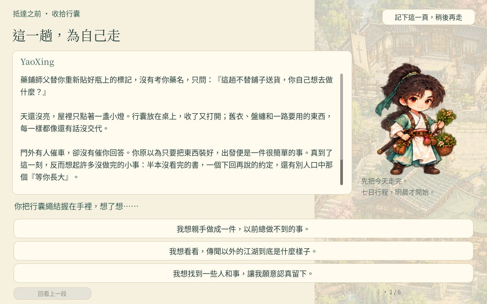
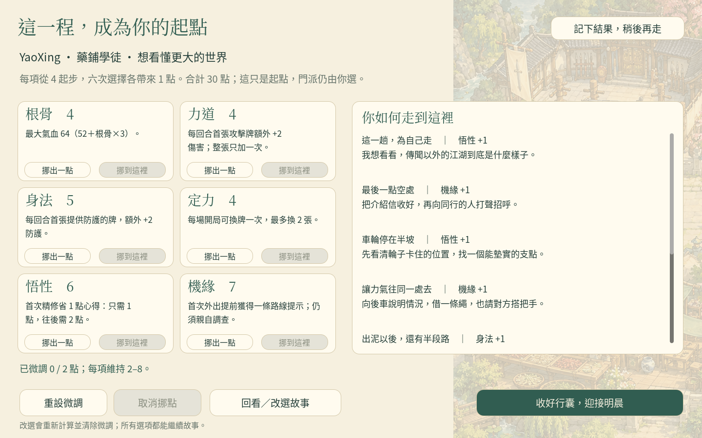
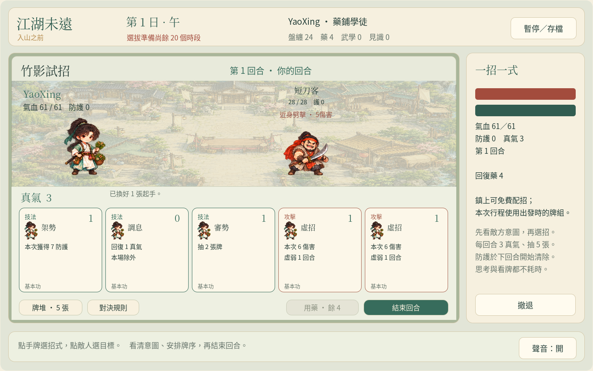

# 《江湖未遠》情境建角・武俠卡牌試玩

先在序章〈抵達之前〉決定自己如何行事，再走進望溪鎮，安排七日的學武、交友與探索。戰鬥採用公開敵方意圖的回合制卡牌，沒有操作倒數。

## 下載與開啟

- [下載卡牌試玩包](https://github.com/cclodty/Game-develop-rpg-wusha/raw/refs/heads/weiyuan-cards-download/jianghu-weiyuan-cards-web.zip)
- [下載 Godot 原始專案](https://github.com/cclodty/Game-develop-rpg-wusha/raw/refs/heads/weiyuan-cards-download/jianghu-weiyuan-cards-source.zip)
- [檔案 SHA-256](SHA256SUMS.txt)

Windows：下載試玩 ZIP，按右鍵選「全部解壓縮」，進入資料夾後雙擊 **Play-Windows.cmd**。遊戲會在瀏覽器開啟，遊玩時保留啟動視窗。不需安裝 Godot 或 Python。

若瀏覽器沒有自動開啟，等啟動視窗顯示 ready 後，開啟 `http://127.0.0.1:8071/`。請從解壓後的資料夾啟動，勿直接在 ZIP 內執行，也不要直接雙擊 `index.html`。

macOS／Linux 可在解壓資料夾執行 `python3 tools/serve_web.py`，再開啟顯示的網址。

## 這次可以玩到

- 三種出身、六次情境選擇、分支回應、能力來源回顧與最多兩點微調。
- 可行走的望溪鎮、兩處探索地點、六名主要人物、七日安排與第八日選拔。
- 十八種招式，十張出戰牌、同種最多兩張；每回合五張手牌、三點真氣。
- 免費配招、招式精修、兩派養成路線、戰敗重試與認輸收尾。
- 建角、日期、人物關係、牌組、手牌與抽牌狀態的獨立存讀。

新學會的招式會加入牌庫，需在鎮上的「角色與配招」換進上場十張牌。活動開始前會顯示成本；思考、閱讀和走路不扣行程。

## 企劃與驗證

- [完整遊戲企劃](https://github.com/cclodty/Game-develop-rpg-wusha/blob/weiyuan-card-prototype/docs/GAME_DESIGN.md)
- [序章六題與完整分支樣稿](https://github.com/cclodty/Game-develop-rpg-wusha/blob/weiyuan-card-prototype/docs/PROLOGUE_SAMPLE.md)
- [十八種牌與精修設計](https://github.com/cclodty/Game-develop-rpg-wusha/blob/weiyuan-card-prototype/docs/CARD_DESIGN.md)
- [驗證記錄與限制](https://github.com/cclodty/Game-develop-rpg-wusha/blob/weiyuan-card-prototype/docs/VALIDATION.md)
- [本下載包的版本與驗證檔案](validation/)

序章 6–8 分鐘、首篇 30–60 分鐘是設計目標。三名首次玩家實測仍待安排，已備妥試玩流程與紀錄表。真正 Windows 桌面與中文輸入法仍待實機驗證。

## 實際遊戲畫面

## 舊版與存檔

原本的[即時戰鬥試玩版](https://github.com/cclodty/Game-develop-rpg-wusha/tree/weiyuan-download)繼續保留。本卡牌版使用本機埠 8071 與 `run-cards-v2.json`，舊動作版使用 8070 與 `run-v1.json`。

請用相同瀏覽器與網址續玩；瀏覽器存檔保存在網站資料中，沒有雲端帳號同步。清除網站資料會移除存檔。
