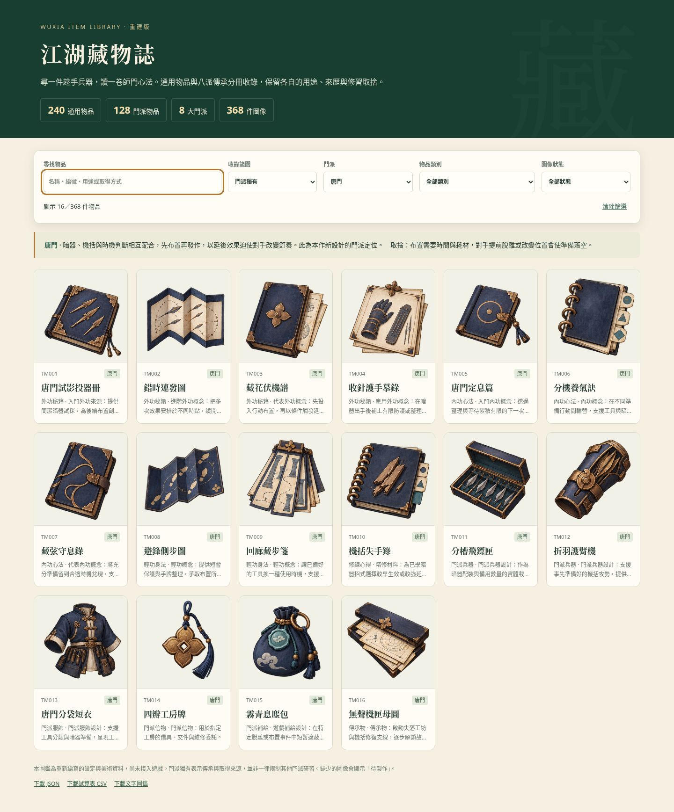

# 武俠物品庫：368 件重建版

**[下載完整資料與圖片包（約 35 MB）](https://github.com/cclodty/Game-develop-rpg-wusha/raw/refs/heads/wuxia-items-download/wuxia-items-368.zip)**

如果點擊後未開始下載，請開啟 [ZIP 檔案頁](https://github.com/cclodty/Game-develop-rpg-wusha/blob/wuxia-items-download/wuxia-items-368.zip)，按右上方的 **Download raw file／下載原始檔** 按鈕。

## 開啟圖鑑

1. 下載 ZIP，按「全部解壓縮」。
2. 進入 `wuxia-item-library` 資料夾。
3. 雙擊 `index.html`，用瀏覽器查看與搜尋；不需要安裝遊戲引擎、Python 或啟動伺服器。

GitHub 檔案頁只顯示 HTML 原始碼；下載並解壓後才可使用互動圖鑑。

## 收錄內容

- 240 件江湖通用物品。
- 少林、武當、峨眉、華山、崑崙、崆峒、丐幫、唐門，各 16 件獨有物品，共 128 件。
- 每派含外功秘籍 4、內功心法 3、輕功身法 2、修練心得 1、兵器 2、服飾 1、信物 1、補給 1、傳承物 1。
- 23 張原始透明 PNG 圖集、368 個物品圖示區域，附來源、提示詞、SHA-256 與實測取圖座標。
- JSON、CSV、文字清單、離線圖鑑及維護工具均收錄於此儲存庫的 [wuxia-item-library](wuxia-item-library/) 資料夾。

[查看物品表 CSV](wuxia-item-library/catalog.csv) · [查看完整 JSON](wuxia-item-library/catalog.json) · [查看文字圖鑑](wuxia-item-library/CATALOG.txt)

這是重新設計的設定與素材庫，未宣稱恢復原有 240 件的逐項對照，尚未接入遊戲。門派獨有表示傳承及取得來源，並非一律限制其他門派研習。

## 驗證與備份

資料與圖片索引已驗證：368 個 ID／名稱唯一、23 張透明 PNG、368 個實測區域及來源雜湊一致。圖鑑的搜尋、八派篩選、內功分類、詳情視窗與手機排版已檢查；瀏覽器圖片實測為唐門 16 件。圖集可能保留微弱的生成邊緣雜點，原 PNG 像素未經修改。

完整 ZIP 的 SHA-256 見 [SHA256SUMS.txt](SHA256SUMS.txt)；包內另有逐檔校驗值。圖片、設定及工具已獨立保存，可下載備份，無須依賴聊天工作區。
