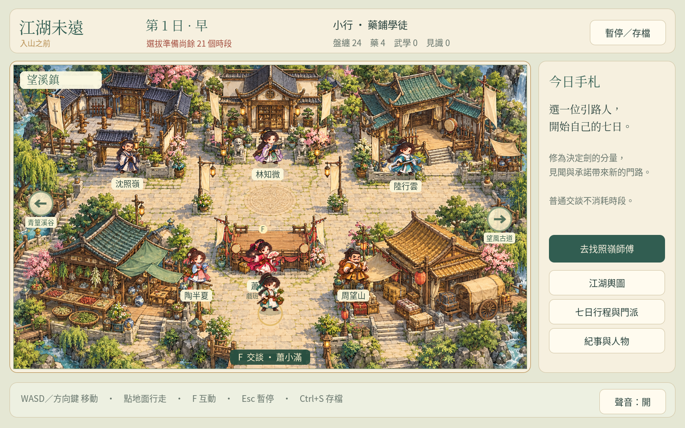

# 江湖未遠 · 入山之前

原創 Q 版武俠養成 RPG 的第一個可玩首篇。七日安排，一程江湖。

## 下載與開始

**[下載可玩版本：jianghu-weiyuan-web.zip](https://github.com/cclodty/Game-develop-rpg-wusha/raw/refs/heads/weiyuan-download/jianghu-weiyuan-web.zip)**

1. 下載完成後，在 ZIP 上按右鍵，選「全部解壓縮」。
2. 進入解壓後的 `jianghu-weiyuan-web` 資料夾。
3. 雙擊 **`Play-Windows.cmd`**。瀏覽器會自動開啟遊戲；遊玩時保留啟動視窗。

不需要安裝 Godot 或 Python。Windows 啟動器使用內建 PowerShell；若瀏覽器未自動開啟，等待啟動視窗顯示 ready 後，開啟 **http://127.0.0.1:8070/**。請先解壓，勿在 ZIP 裡直接開啟檔案，也勿直接雙擊 `index.html`。

macOS／Linux 可在解壓後的資料夾執行 `python3 tools/serve_web.py`，再開啟終端顯示的網址。

## 首篇內容

- 三種出身、自訂姓名、七日早午晚共 21 時段，第八日入門選拔。
- 望溪鎮、青篁溪谷與望風古道；六名主要人物、16 種活動。
- 劍術連段、閃避、劍氣與突進；兩種普通敵人、兩階段考核頭目。
- 勤學、人情與探索可混合；照嶺門、渡雲社或留鎮續修三種收束。
- 完整繁體中文劇本、統一 Q 版美術、自動存檔與戰鬥／對話續玩。

WASD／方向鍵移動，F 互動；左鍵／J 出劍，Space 閃避，Q／E 已學武功，R 用藥，Esc 暫停。走路與閱讀不耗時；安排活動前會顯示成本，戰敗重試不重扣時段。

## 原始碼與驗證

[瀏覽 Godot 原始碼](https://github.com/cclodty/Game-develop-rpg-wusha/tree/weiyuan-first-chapter) · [下載原始碼 ZIP](https://github.com/cclodty/Game-develop-rpg-wusha/raw/refs/heads/weiyuan-download/jianghu-weiyuan-source.zip) · [SHA-256 校驗碼](SHA256SUMS.txt) · [詳細驗證記錄](https://github.com/cclodty/Game-develop-rpg-wusha/blob/weiyuan-first-chapter/docs/VALIDATION.md)

使用 Godot 4.6.3 與 Dialogue Manager 3.10.4。雲端測試涵蓋規則、戰鬥、場景、劇本、介面及 Chromium 真實輸入；Windows 啟動伺服器在 Linux 上的 PowerShell 驗證，尚未作原生 Windows 實機驗收。首篇 30–60 分鐘仍是待真人試玩的目標；角色使用姿態插畫與程式動作，逐格動畫、後續章節尚未製作。

本作存檔與舊版分開。固定使用同一瀏覽器及網址續玩；清除網站資料會刪除瀏覽器存檔。

舊版《山河行》仍保留於 [playable-download](https://github.com/cclodty/Game-develop-rpg-wusha/tree/playable-download)，沒有被本次版本覆蓋。
