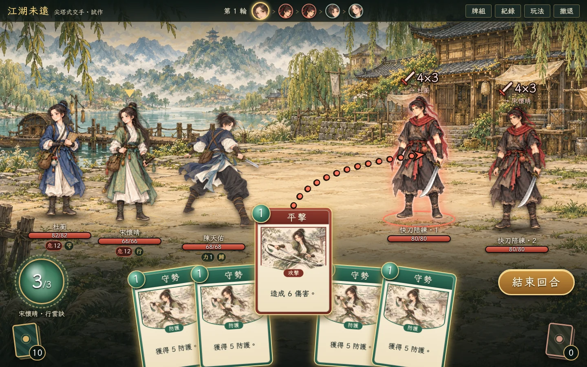

# 尖塔式交手 · 試作

2026-10-29。使用者要求：戰鬥試玩改成接近《殺戮尖塔》的手感，包括出牌方式。

入口：[spire/](../spire/index.html)，合併到 `gh-pages` 後網址為 https://cclodty.github.io/Game-develop-rpg-wusha/spire/ 。

## 與試牌場的關係

- 規則、卡牌、數值、內功與對手全部沿用 `battle/` 的 basic-v1 純模型：直接 import `battle/catalog.mjs`、`battle/model.mjs`，兩檔未修改。本頁只換畫面與操作。
- 存檔為 `jianghu-combat-spire-v1`，與試牌場 `jianghu-combat-lab-v1`、章節 `jianghu-gal-web-v1:*` 分開，不互相讀寫。
- 開局只選對手、人數，以及宋懷晴、杜蘅是否自動出牌。三人用十五張起步牌與預設內功；配招、裝備、種子仍在試牌場調整。

## 出牌

- 手牌扇形排在下方。滑過放大，旁邊列出相關關鍵字（防護、破架、除外、內功觸發、對手反制等）。
- 拖曳：防護／技巧牌拖上戰場放手即施展；攻擊牌拖出手牌區後停在中下方，拉出箭頭，指向對手放手。拖回手牌區或放在空處取消。
- 點選：點一下手牌，再點對手（攻擊）或戰場（其他）施展。右鍵、Esc 或再點同一張取消。
- 鍵盤：1–0 選牌，Tab／方向鍵換目標，Enter 施展，E 結束回合。
- 真氣不足時人物頭上冒出「真氣不足。」，牌回到手上。可出的牌有金邊，沒有可出的牌時「結束回合」發光。

## 畫面

- 左下真氣珠（顏色隨出手人物）與抽牌堆，右下棄牌堆，除外有牌才顯示；點牌堆可看內容，抽牌堆不顯示順序。
- 上方行動次序依速度輪轉。換人時有橫幅；抽牌從抽牌堆飛入，結束時全棄飛入棄牌堆，抽牌堆用完時有洗牌動畫。
- 對手頭上是公開意圖：攻擊數值×段數、防護、蓄勢、反制，以及攻擊目標。被瞄準的同伴血條下顯示「危」與本輪將受傷害；滑過對手時，其目標腳下亮紅圈。
- 施展：出手人物前衝、刀光、傷害數字、受擊震動，重擊時畫面輕震；防護顯示盾牌與數字，血條轉藍；調息施展後燃盡除外。
- 掠步施展後出現「換牌」畫面：選一張手牌棄掉再抽一張，或不換。換牌中重新整理會回到同一畫面。
- 自動同伴使用模型的 `chooseAI`，出牌動畫與手動相同。

## 美術

- 陳天佑：`battle-back-hero.png`；宋懷晴、杜蘅：`characters-illustrated.png` 中對應立繪。均以 CSS 裁切顯示，原圖不變。
- 陪練暫借同圖集的人物：快刀＝bandit、持盾＝lancer、蓄勁＝examiner、拆招＝shen。這只是試作佔位，正式對手需要各自的立繪。
- 卡面沿用十八張獨立招式圖；框色依分類（攻擊赭紅、防護青綠、技巧靛藍），攻擊圖框下緣收尖、防護圖框下緣圓弧。全介面文楷。

## 驗證

- `node tools/test_spire_web.mjs`（需 Playwright）：在 GitHub Pages 專案路徑以真實滑鼠／鍵盤打完六場（四類對手各一人，加拆招、快刀各兩人），每場都用到拖曳、點選、鍵盤與中途重新載入，並經過掠步換牌；另在 960×600 以自動同伴開局。沒有頁面錯誤或 4xx 回應。截圖輸出到 `artifacts/spire/`。
- `node --test tests/test_basic_battle.mjs tests/test_basic_card_art.mjs` 17 項仍通過（模型未改）。
- 已目視檢查 1440×900 與 960×600：準備、出手橫幅、瞄準、受擊、換牌、牌堆、結果畫面。

## 未做／待定

- 回合結構仍是試牌場的「依速度逐人輪流」。若要更接近尖塔（我方三人同一回合出牌，再輪到敵方），需要改模型規則，本輪未處理。
- 沒有戰後選牌、地圖、遺物或藥水；只有單場交手。
- 對手立繪為佔位；人物沒有逐格攻擊動畫，只有程序式前衝與震動。
- 以桌面橫向為主，手機直向未調校。
